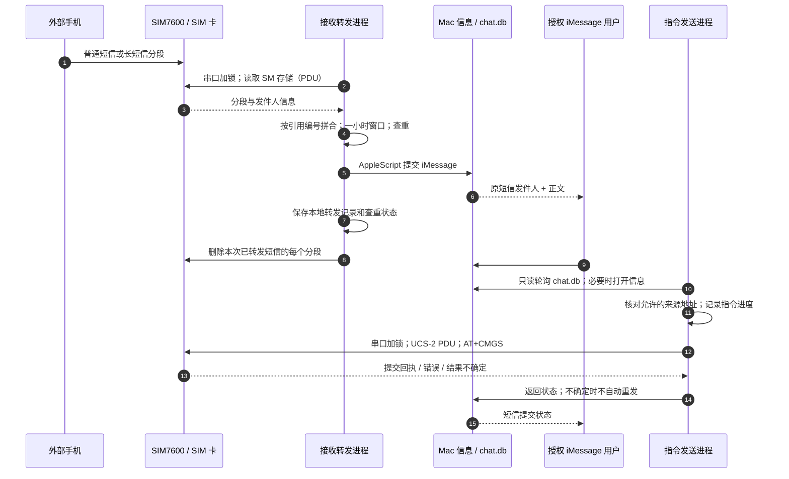

# SIM7600 ↔ iMessage Bridge

把一张实体 SIM 卡变成可通过 iMessage 使用的短信入口：SIM7600 收到的短信转发到 iPhone；从授权的 iMessage 地址发送 `#短信 +国家区号手机号 正文`，再由模块里的 SIM 卡发出短信。项目还包含配套的三件式桌面外壳和四种可替换小摆件。

本项目在 **macOS + 微雪 Waveshare SIM7600X 4G HAT + SIMCom SIM7600CE-T** 上实测。`SIM7600X 4G HAT` 是载板名称，金属模块上的 `SIM7600CE-T` 才是具体蜂窝模块型号；不同 SIM7600 型号、板卡修订和运营商的兼容性不能直接类推。

## 项目目录

```text
scripts/                    短信双向桥接、示例配置、安装工具、测试
3d-printing/
  enclosure/                最终 V0.32 外壳：STL、STEP、参数、CAD 源码、预览
  plugins/                  原机器人 + 宇航员/方头猫/复古电视 STL、源码、预览
```

软件仅使用 Python 标准库；反向读取 iMessage 富文本另需一个 Foundation 小工具，安装时从源码编译。3D 打印文件可以直接交给打印店，无需安装 CAD 环境。

## 硬件、固件和运营商

- SIM7600CE-T / SIM7600X 4G HAT、可用的 SIM 卡、MAIN 天线、可靠的 USB 电源及数据线。
- 使用板上 **USB TO UART** 接 Mac；旧版板的两枚 UART 选择跳线设在 **C**，让 CP2102 与 SIM7600 通信。先确认对应修订的官方接法。
- 串口默认 `/dev/cu.usbserial-0001`、115200 波特率，实际设备名通过 `ls /dev/cu.*` 查看；在配置中修改。
- 中国电信卡在本机固件更新后已经实测短信和电话；移动卡也做过短信测试。这是本机测试结果，不保证所有卡、套餐、地区或模块固件均兼容。
- 需要电话功能时，SIM 卡、运营商和模块固件需共同支持所用语音方案/VoLTE。收到 `+CMGS` 只表示模块明确提交了短信，不代表对方已经收到。
- 第三方 Windows 驱动、烧录工具和微雪提供的固件 **不在仓库内分发**。应向微雪确认匹配具体模块的版本，不要把不同后缀型号的固件混刷。本机升级包与升级前后检查清单记录的目标版本为 **LE11B14SIM7600M22**，用户已确认按支持人员要求升级并完成电信测试；该版本不是对所有型号的通用升级建议。

[微雪对应模块 Wiki](https://www.waveshare.com/wiki/SIM7600CE-T_4G_HAT) · [系列 HAT 官方说明](https://www.waveshare.com/wiki/SIM7600X_4G_%26_LTE_Cat-1_HAT)

### 版本与复现环境

| 项目 | 已确认记录 |
|---|---|
| 载板与模块 | Waveshare SIM7600X 4G HAT，SIMCom SIM7600CE-T；旧布局，右侧单排针标有 PWR、GND，UART 跳线设 C，VCCIO 设 3.3 V。未找到可确认的 PCB 修订编号。 |
| 固件 | 升级资料记录从 LE11B11SIM7600M22 / B11V02 升至 LE11B14SIM7600M22。升级包与用户升级确认可追溯；未保留公开的升级后 AT+CGMR 原始读回，部署时仍需核对。 |
| 文档整理与离线验证主机 | 2026-10-10：macOS 27.0.1（26A434）、arm64、Python 3.9.6。这是当前主机记录，不代表所有历史实测都使用相同系统版本。 |
| 升级方式 | Windows + QDL V1.41，9x07 平台；烧录使用模块原生 USB，日常桥接使用 USB TO UART，两者不要混淆。 |

本地留存的 `LE11B14SIM7600M22.zip` SHA-256：

```text
a663f006706197a40818df4507aa27b6c28d2c0ebd72764efd5f58e6dced40eb
```

校验值用于识别本项目留存的升级包，不代表厂家签名或兼容性认证。固件应向微雪支持索取并确认适配，不随仓库发布。

检查实际固件和网络时，先停用两个桥接进程，释放串口，再用串口工具逐条执行以下只读命令；核对后关闭工具并恢复服务：

```text
AT
AT+CGMR       // 预期包含 LE11B14SIM7600M22
AT+CSUB       // 记录子版本
AT+CPIN?      // 预期 READY
AT+CEREG?     // 已注册通常为 1 或 5
AT+CPSI?      // 记录实际网络制式和状态
AT+CSQ        // 信号读数
AT+CSCA?      // 读取短信中心号码
AT+CPMS?      // 读取存储使用量
```

`//` 后是说明，串口只发送命令本身。不要根据别人的卡直接覆盖短信中心号码，也不要把查询输出中的个人信息公开。

### 通电后自动启动模块

我们实测的旧版载板：**断电后，用一根 2.54 mm 母对母杜邦线连接右侧排针上的 PWR 与 GND**。重新接电后，模块自行启动，等待约十几秒 NET 灯闪烁，免去每次短按 PWRKEY。PWR 是控制针脚；PWR 灯常亮本身不能证明蜂窝模块已经启动。不要误接相邻 5V，也不要挪动 VCCIO 电平跳线。

**这不是所有修订通用的接法。**微雪新版有独立自动上电配置，官方要求 PWR–3V3；必须按实物标识和对应 Wiki 判断。旧版与新版不要混用。NET 灯反映模块/网络状态，无法在尚未启动的模块上通过 AT 指令直接让它闪烁。

## 短信收发时序



接收端约每 5 秒轮询；反向指令约每 3 秒轮询。正常情况下时延较短，网络、信息应用响应及 Mac 休眠可能影响时延。长短信的每段时间可能不同：修复后的逻辑以发件人、分段引用和总段数匹配，并限制在一小时内；不齐的分段会保留等待，不会擅自删除。

## 安装和配置

需要 macOS、Python 3.9+、已登录 iMessage 的“信息”应用及 Xcode Command Line Tools。若缺少编译器，先运行 `xcode-select --install`。建议使用固定路径的 Python；以后更换解释器，要同步更新 LaunchAgent 和隐私授权。

```sh
python3 scripts/install.py
```

在 `~/Library/Application Support/SIM7600Bridge/` 编辑两个配置：

`bridge_config.json`：

```json
{
  "serial_port": "/dev/cu.usbserial-0001",
  "forward_to": "你的 iPhone iMessage 手机号或邮箱"
}
```

`sender_config.json`：

```json
{
  "allowed_senders": ["你发送指令时实际使用的 iMessage 手机号或邮箱"]
}
```

Mac 可以用 Apple ID 邮箱接收指令，iPhone 可以用手机号接收转发，便于分开会话、减少自己给自己发消息产生的重复显示。Mac 的接收地址在“信息 → 设置 → iMessage”中配置；脚本配置的是**转发目标**和**允许的指令来源**，不是修改 Apple 账户设置。未配置来源名单时，反向发送程序拒绝运行。短信接收转发不会限制原短信发件人的号码。

### 必须开启的权限和系统条件

| 项目 | 用途与操作 |
|---|---|
| 完全磁盘访问权限 | 反向进程只读 `~/Library/Messages/chat.db`。系统设置 → 隐私与安全性 → 完全磁盘访问权限，添加安装工具显示的实际 Python 解释器；手动测试的终端也可能需要授权。切换 Python 或后台运行方式后需重新检查。 |
| 自动化 → 信息 | 允许负责运行脚本的 Python/终端通过 AppleScript 控制“信息”。首次测试发送时 macOS 会弹窗，批准控制信息；实际显示的主体依 macOS 和解释器安装方式不同。 |
| iMessage 登录及联网 | Mac 需登录可用 iMessage 账户。“信息”窗口无需一直放在前台；程序会在关闭时重新打开应用，并在超时后尝试恢复。 |
| 后台运行、登录、休眠 | LaunchAgent 是当前用户登录后的任务，不是在登录前启动的系统服务。Mac 需要保持运行和联网；深度休眠/关机期间不会桥接。保持供电并按需设置防止自动睡眠。 |
| 串口可用 | 配置正确端口、可靠供电；不要让串口调试软件同时占用设备。两个桥接进程用同一锁文件串行操作。 |

**不需要“辅助功能”或屏幕录制权限**；本项目不通过 UI 自动点击信息应用，也不修改信息数据库。

授权后验证数据库权限：

```sh
python3 "$HOME/Library/Application Support/SIM7600Bridge/imessage_sms_sender.py" --check-access
```

首次使用可先在两个终端分别运行接收、发送脚本，以触发权限请求并检查日志，再启用后台服务。迁移本项目已有安装时，应先停用旧 LaunchAgent，避免旧服务与新服务同时工作。不要删除原来的状态文件，否则会改变首次扫描/查重行为。

```sh
python3 scripts/install.py --start
launchctl list | grep com.sim7600bridge
```

安装工具创建 `com.sim7600bridge.receive` 和 `com.sim7600bridge.send` 两个用户 LaunchAgent，记录日志到应用数据目录。配置、状态、历史短信和日志留在本机，均被 `.gitignore` 排除。

### 日常使用

从允许的 iMessage 地址向 Mac 的 iMessage 接收地址发：

```text
#短信 +国家区号手机号 这是一条测试短信
```

目标号码必须是 `+` 开头的国际格式，正文 1–1000 字符。中文、英文及混合内容用 UCS-2 PDU，超长正文拆分发送，会产生多段短信费用。失败或提交不确定会返回状态；为了避免重复扣费，不自动重发不确定的短信。对方是否收到需对方确认。

接收端一分钟检查一次 SIM 就绪、LTE 注册、信号和短信槽位，连续异常后告警，同一异常约一小时提醒一次，恢复后通知。**不能直接确认欠费**，只能看到可能由欠费、覆盖、天线或运营商导致的网络异常。如果 iMessage 本身失败，异常告警也可能无法送达。

## 3D 打印


最终外壳是 V0.32：黑色 `base`、黑色 `lid-carrier`、石灰白色 `top-cover` 三件。顶部正方形盲孔 4.4×4.4 mm；原机器人插头 4×4 mm，在本机打印样件中偏松，新三款插件改为 4.2×4.2 mm、插入 1.65 mm、末端导入斜面，可每 90° 调整方向。宇航员、方头猫、复古电视为放大后的形象，眼口加深版本 V2；不需要重打顶盖。

- 建议外壳使用 PETG，两个黑色部件与一个白色部件分别打印。实际散热和环境温度仍需实测。
- 插件建议先试插，不要强压；打印机尺寸误差会影响紧度。新插件的实物紧度、倒伏稳定性和面部细节尚待打印验证。
- STL 单位 mm；外壳 STEP 和参数用于继续改设计。外壳源代码的 Ben 刻字使用 macOS 系统 Apple Chancery 字体：仓库不分发字体；其他平台重新生成时需要选择合法可用字体，尺寸可能不同。
- 有悬挑的小形象请让打印店检查支撑与摆放方式；安装柱与插头处不要随意缩放。仓库中的插件 STL 已检查封闭网格。

## 验证记录、项目进度和待办

已验证：固件更新后的电信短信/拨号、移动短信、双向 iMessage 桥接、中文及英文发送回执、后台运行/信息关闭后的重启、状态通知、长短信拼合后清理存储、旧版 PWR–GND 自动上电。一次长短信修复实测把 38 个分段还原成 16 条短信，转发后存储从 38/40 降到 0/40。

外壳经过多次实物试装，解决接口、针脚净空、安装柱与顶盖装配问题；最终结构 CAD 为 V0.32。最终外壳与各版新插件具体打印配合仍需在目标打印机上复核。

### 已完成与待验证的边界

| 项目 | 结果与证据 |
|---|---|
| 电信短信、拨号 | 固件更新后，用户确认 Windows 短信成功；Mac 测试电话接通、中文/英文短信到达。 |
| 双向 iMessage | 用户确认接收转发和反向短信到达；发送状态及应用关闭后的恢复已有测试。 |
| 长短信与存储 | 修复按每段精确时间分组的问题；一次实测 38 个分段拼成 16 条，转发清理后 0/40。缺段和删除失败重试仍有下述限制。 |
| 自动上电 | 用户确认旧布局 PWR–GND 接线后可自动启动；不是新硬件修订的实测记录。 |
| 离线软件检查 | 7 项协议回归测试通过；Python 编译检查、Foundation 解码器编译通过。离线测试不代替真实运营商送达测试。 |
| 外壳与插件 | 早期外壳已实物试装并多轮调整；最终 V0.32、4.2 mm 插头 V2 的最终实物验收未记录，不能当作已完成。 |

尚缺/后续关键点：

1. 补存升级后 AT+CGMR / AT+CSUB 原始版本读回、准确 PCB 修订编号；目前已有目标升级包与当前系统环境记录。板卡照片如后续加入，必须遮盖 IMEI、MEID、SN 和个人信息。
2. 长短信引用重用/跨时区时间、缺失或格式损坏分段的更完整测试；不齐分段的过期处理目前没有自动清理策略，仍可能占满存储。
3. iMessage 提交成功 ≠ 对方收到；接收程序在提交后保存记录并删除分段，未验证端到端送达。发送与状态保存之间异常退出，也不能承诺严格“恰好一次”。
4. 若状态保存后删短信失败，已有查重记录会跳过它，缺少独立的待删除重试队列。
5. 更完整的串口插拔、休眠唤醒、长期稳定性测试；发送进程异常退出依赖 LaunchAgent 重启。
6. 本地短信记录/状态文件尚无滚动保留策略；`--inspect` 会输出最近消息，仅用于本人调试，不要公开其输出。
7. 4.2 mm 插头及三款放大摆件的实物松紧、PETG 打印细节、重心和支撑验证。
8. 富文本解码器使用 macOS 尚可用但已弃用的 NSUnarchiver；当前编译通过，后续应针对系统升级验证兼容性及更安全的解码方案。

运行离线回归测试，不连接串口、不发送消息：

```sh
python3 -m unittest discover -s scripts/tests -v
```

## 许可与第三方资源

本项目自写脚本、CAD 源码与自设计模型采用 MIT License。Waveshare / SIMCom 文档、固件、驱动、Apple 系统字体及 macOS 组件保留各自权利；本仓库只链接第三方说明，不复制其固件包或字体。公开仓库不包含真实短信、电话/邮箱配置、IMEI、MEID、SN 或运行数据库。

### 首次扫描的重要行为

接收程序首次启动且没有状态文件时，会把卡内已有完整短信记录为“见过”，只转发后续新短信；这批历史短信也不会自动删除。若希望接管历史短信，需要先备份并按需求调整初始化逻辑。不要为了清理存储随便删查重状态文件。
