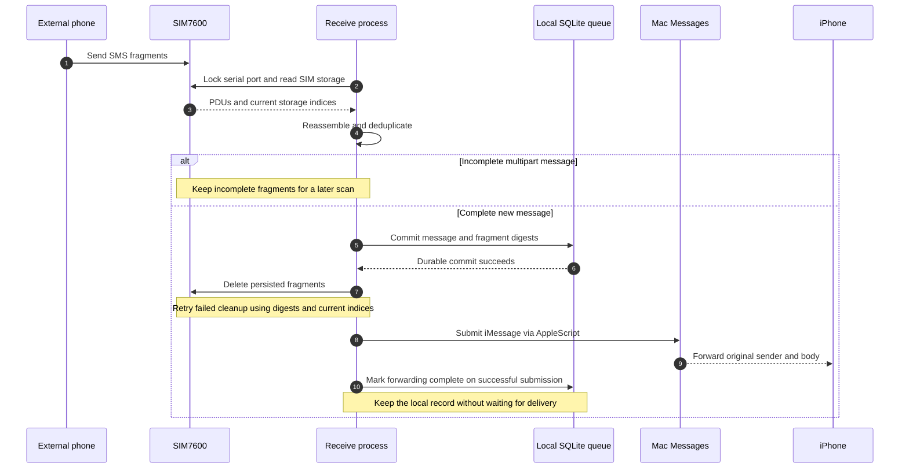
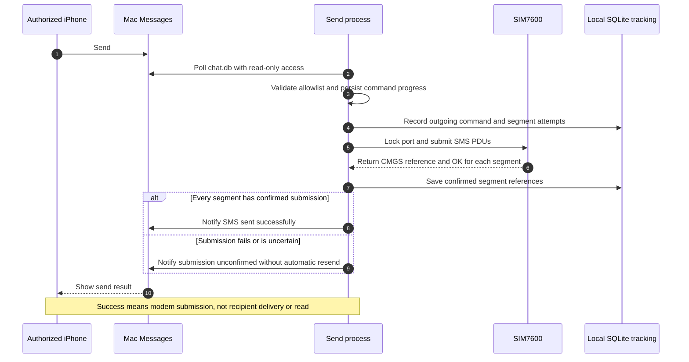

# SMS ↔ iMessage Gateway

Use a physical SIM card through iMessage on a Mac: incoming SMS is forwarded to your iPhone, and commands from an authorized iMessage address send SMS through the SIM7600. The project includes a three-piece desktop enclosure and interchangeable figurines.

Tested hardware: **Waveshare SIM7600X 4G HAT with a SIMCom SIM7600CE-T module**. The HAT name identifies the carrier board; the label on the metal module identifies the cellular variant. Compatibility does not automatically extend to other variants, revisions, carriers, or plans.

## Repository layout

```text
scripts/                    Bridge, example configuration, installers, tests
```

Printable enclosure and figurines are maintained in Ben-3D-Prints (linked below).

The bridge uses the Python standard library. A small Foundation helper decodes iMessage attributed text and is compiled during installation. Print-ready STL files do not require a CAD environment.

## Hardware and firmware

- SIM7600CE-T / SIM7600X 4G HAT, an active SIM, a MAIN antenna, and reliable USB power and data cables.
- Connect the Mac to **USB TO UART**. On the tested older board, both UART jumpers are at **C**, connecting the CP2102 to the module. Confirm the instructions for your revision.
- Default serial port: `/dev/cu.usbserial-0001`, at 115200 baud. Run `ls /dev/cu.*` and update the configuration for your device.
- China Telecom SMS and voice calls worked after the firmware upgrade; China Mobile SMS was also tested. These are results from this setup, not a universal compatibility guarantee.
- Voice/VoLTE requires compatible module firmware, SIM provisioning, and carrier service. `+CMGS` confirms submission, not delivery.
- Firmware, Windows drivers, and flashing tools are **not redistributed**. Ask Waveshare for firmware matching the exact module variant.

[Module Wiki](https://www.waveshare.com/wiki/SIM7600CE-T_4G_HAT) · [HAT family documentation](https://www.waveshare.com/wiki/SIM7600X_4G_%26_LTE_Cat-1_HAT)

### Recorded versions

| Item | Evidence |
|---|---|
| Board | Older SIM7600X 4G HAT layout: right-hand header labeled PWR and GND, UART jumpers at C, VCCIO at 3.3 V. Exact PCB revision is unrecorded. |
| Firmware | Upgrade records specify LE11B11SIM7600M22 / B11V02 → **LE11B14SIM7600M22**. The owner confirmed the upgrade and carrier tests. A public post-upgrade AT+CGMR transcript has not been retained. |
| Documentation/test host | 2026-10-10: macOS 27.0.1 (26A434), arm64, Python 3.9.6. Earlier tests may have used different OS versions. |
| Flashing | Windows, QDL V1.41, 9x07 platform. Flash through native **USB**, rather than the **USB TO UART** used by the bridge. |

SHA-256 of the locally retained `LE11B14SIM7600M22.zip`:

```text
a663f006706197a40818df4507aa27b6c28d2c0ebd72764efd5f58e6dced40eb
```

This identifies the retained archive; it is not a manufacturer signature or certification. Obtain compatible firmware from Waveshare support.

Stop both bridge processes before using a serial terminal. Send only the commands below, without the comments; close the terminal before restarting the bridge.

```text
AT
AT+CGMR       // Expect LE11B14SIM7600M22 on this setup
AT+CSUB       // Record the sub-version
AT+CPIN?      // Expect READY
AT+CEREG?     // Registration usually reports 1 or 5
AT+CPSI?      // Network technology and state
AT+CSQ        // Signal quality
AT+CSCA?      // SMS service center
AT+CPMS?      // Storage usage
```

Do not overwrite your SIM's service-center settings with another user's values. Redact personal identifiers before sharing diagnostics.

### Automatic startup after power connection

On the tested **older board**, disconnect power, then connect **PWR to GND on the right-hand header using one 2.54 mm female-to-female jumper wire**. On reconnecting power, the module starts without pressing PWRKEY; the NET LED begins blinking after roughly a dozen seconds. The PWR LED alone only confirms board power. Do not connect to the adjacent 5V pins or move the VCCIO jumper.

**Revision-specific:** newer boards use a separate automatic-start arrangement documented as **PWR–3V3**. Follow the markings and Wiki for your actual revision. Do not interchange the two arrangements. An unpowered cellular module cannot be started simply by sending an AT command to make NET blink.

## SMS sequence diagrams

### Incoming SMS to iMessage



The SIM is cleared only after the complete message is committed locally. Successful iMessage submission completes forwarding; recipient delivery is not required. Uncertain sends are checked against the Messages database before any retry.

### iMessage command to outgoing SMS



The sender does not request or wait for carrier delivery reports and does not send 24-hour report timeout reminders.

Incoming SMS uses a one-second idle polling interval; commands are polled about every three seconds. Actual scan intervals include modem and queue processing time. Carrier delivery-report storage is no longer polled. Complete messages in the same scan are sorted by earliest SMSC timestamp with SIM index as a tie-breaker; eligible queue records are processed by enqueue time and insertion order, without prioritizing new records over older retries. Carrier/network arrival order, incomplete multipart messages, retry backoff and iMessage transport can still affect the order seen on the phone. Network conditions, Messages responsiveness, and Mac sleep affect latency. Multipart grouping uses sender, reference, total segment count, and a one-hour window; timestamps need not match exactly. Incomplete messages remain on the SIM. Complete messages are persisted before SIM cleanup, independently of iMessage availability.

## Installation

Requirements: macOS, Python 3.9+, a signed-in iMessage account, and Xcode Command Line Tools. Install the tools with `xcode-select --install` if needed. Keep the interpreter at a stable path; changing it requires updating LaunchAgents and privacy permissions.

```sh
python3 scripts/install.py
```

Edit these files in `~/Library/Application Support/SIM7600Bridge/`:

**bridge_config.json**

```json
{
  "serial_port": "/dev/cu.usbserial-0001",
  "forward_to": "YOUR_IPHONE_IMESSAGE_ADDRESS"
}
```

**sender_config.json**

```json
{
  "allowed_senders": ["YOUR_COMMAND_SENDER_ADDRESS"]
}
```

### Separate Mac and iPhone iMessage identities

For a Mac and iPhone signed in to the same Apple Account, use different iMessage addresses for the gateway and the phone. This is the owner's tested setup and helps avoid confusing self-addressed conversations with both sent and received copies.

| Device | Enabled receiving address | Start new conversations from | Role |
|---|---|---|---|
| Mac | Only the chosen Apple Account email | The same email | Receive SMS commands; send forwarded SMS and status notices |
| iPhone | Only the chosen phone number | The same phone number | Send commands to the Mac email; receive gateway messages |

1. On the Mac, open **Messages → Settings → iMessage**. Under **You can be reached for messages at**, keep only the gateway email selected; choose it under **Start new conversations from** if that selector is shown.
2. On the iPhone, open **Settings → Apps → Messages → Send & Receive** (or **Settings → Messages** on older iOS). Keep only the chosen phone number enabled for receiving/replying and select it for new conversations if the selector is shown. Keep iMessage signed in and enabled on both devices.
3. Set `bridge_config.json` → `forward_to` to that iPhone number, including country code. Set `sender_config.json` → `allowed_senders` to the same number. From the iPhone, address `#sms` commands to the Mac email, not to the SIM card number.
4. Create separate contacts such as **Yu's Mac** (the gateway email only) and **Yu Ren** (the iPhone number only). Keep these identities in separate contact cards; contact names are labels, while the actual email/number determines routing. Start a new conversation addressed explicitly to the gateway email; existing conversations can retain their previous identity.

These settings affect your other iMessage conversations too: the Mac uses the email, while the iPhone uses the phone number. They separate addresses, not Apple Accounts. **Messages in iCloud is a separate history-sync feature**; shared conversation history can still appear on both devices when it is enabled. Address separation is not a guarantee of zero duplicate bubbles, and the bridge does not delete iMessage history to hide copies. If history isolation is desired, review Messages in iCloud for the Mac separately; disabling it affects history synchronization, not iMessage sign-in.

See Apple's [Messages setup on Mac](https://support.apple.com/en-gb/guide/messages/ichte16154fb/mac) and [Messages in iCloud setup](https://support.apple.com/en-gb/guide/icloud/mm0de0d4528d/icloud).

The script settings control the forwarding destination and permitted command sources; they do not alter Apple account settings. An empty allowlist disables sending. Incoming SMS forwarding accepts all original SMS senders.

### Permissions and operating conditions

| Requirement | Purpose |
|---|---|
| Full Disk Access | Read-only access to `~/Library/Messages/chat.db` for commands and reconciliation of uncertain submissions. In System Settings → Privacy & Security → Full Disk Access, add the actual Python interpreter shown by the installer. A terminal used for manual checks may need its own authorization. |
| Automation → Messages | Allow the responsible Python/terminal process to control Messages using AppleScript. Approve the first automation prompt. The displayed permission owner depends on the OS and interpreter. |
| iMessage login and connectivity | Messages need not remain in the foreground. The bridge reopens it when closed and attempts recovery after timeouts. |
| Logged-in, awake Mac | LaunchAgents run after user login, not before login. Sleep and shutdown suspend the bridge. Keep the Mac powered and connected. |
| Available serial port | Use the correct device and stable power. Do not simultaneously open it in another terminal. Both bridge processes share a serial lock. |

Accessibility and screen-recording permissions are not required. The scripts do not click the UI or modify the Messages database.

Optional manual database check, under a permission-enabled terminal:

```sh
python3 "$HOME/Library/Application Support/SIM7600Bridge/imessage_sms_sender.py" --check-access
```

Terminal permission failure does not necessarily mean the background LaunchAgent lacks permission; check the background logs separately. Start manually to trigger automation prompts, then enable both services:

```sh
python3 scripts/install.py --start
launchctl list | grep com.sim7600bridge
```

The installer creates `com.sim7600bridge.receive`, `com.sim7600bridge.send`, and the independent `com.sim7600bridge.watchdog`. Logs, configuration, state, and message history stay in the local application directory and are excluded from Git. Stop any older installation before starting a second set of services. Preserve existing state during migration.

### Usage and delivery status

Send from an allowlisted address to the Mac's iMessage address:

```text
#sms +15550000000 This is a test message
```

The destination must use international `+` format. Bodies contain 1–1000 characters. Unicode text uses UTF-16BE SMS PDUs; longer bodies are segmented and may incur multiple SMS charges. The original Chinese command keyword remains accepted for backward compatibility.

- **Incoming queue:** `delivery.sqlite3` commits the complete SMS before SIM deletion. Cleanup retries use saved PDU digests and current indices, including partially deleted multipart messages. Keep this database and the original state files.
- **iMessage:** successful AppleScript submission completes forwarding (`submitted` is a terminal queue state, as is legacy `delivered`). No recipient delivery confirmation is required, and these messages are not rechecked or resent if they disappear from Messages history. Uncertain submissions still reconcile recipient, body, outgoing record and GUID before retrying; unavailable database permissions or ambiguous matches prevent blind resends. Failed submissions can retry with backoff, at most eight attempts.
- **Outgoing SMS:** success is acknowledged immediately after every segment returns `+CMGS` and `OK`. Carrier reports are not requested or awaited, and no 24-hour timeout notice is generated. Submission errors or uncertain results still produce a notice without automatic resend, to avoid duplicates. Success confirms modem submission, not receipt or reading by the recipient.
- **Health:** SIM readiness, network registration, signal, and SMS storage are checked about once a minute. Persistent anomalies produce alerts, roughly hourly while unresolved, followed by recovery notices. This cannot directly identify an unpaid balance. An iMessage outage can also prevent alerts from arriving.

Successful submission logs include queue age and AppleScript submission duration, without message bodies, to help distinguish local queue delays from carrier or iMessage transport delays.

### Automatic forwarding recovery

An independent watchdog checks the local queue, receiver heartbeat and both LaunchAgents every 30 seconds. It does not send SMS or modify forwarding records.

- A message whose iMessage submission remains unresolved three minutes after being queued triggers an iMessage alert. A missing service or receiver heartbeat older than three minutes also triggers recovery checks.
- Stuck receiver work, a stale heartbeat, or a stopped service can trigger a restart. Restart attempts are limited to once per 30 minutes and three recovery cycles per rolling 24 hours; counters survive restarts. Existing Messages history reconciliation still runs before retrying an uncertain forward.
- Messages successfully submitted to iMessage are complete and never trigger backlog alerts or recovery restarts, even if recipient delivery is unconfirmed or the message is later deleted.
- When the services are healthy and all messages tracked during the incident have completed iMessage submission, a recovery notice reports the monitored incident duration and message count. This confirms submission, not recipient delivery or reading.
- Notifications use the configured iMessage forwarding destination. If that channel is unavailable, notices remain pending for retry; no independent notification channel is configured. Revoked macOS permissions can still require manual reauthorization after the automatic restart limit is reached.

Runtime files stay in `~/Library/Application Support/SIM7600Bridge/`: `receive_heartbeat`, `watchdog_state.json`, `watchdog_config.json`, `watchdog.out.log`, and `watchdog.err.log`. No message bodies are written to watchdog state or logs. The watchdog reuses the existing receiver interpreter and recognizes both legacy and current service labels.

For an existing installation, run `python3 scripts/upgrade_existing.py`; it preserves configuration and queue state, upgrades the services, and installs the watchdog. If the scripts have already been updated, `python3 scripts/install_watchdog.py` registers just the watchdog. New installations use `python3 scripts/install.py --start` after configuration.

Carrier reports have **not yet been observed on the tested Telecom setup**, although submission and recipient-confirmed arrival work. The former iMessage delivery observer passed a live test, but routine delivery verification is now disabled; only uncertain submissions use history reconciliation. See the [SIM7600 AT manual](https://files.waveshare.com/upload/6/68/SIM7500_SIM7600_Series_AT_Command_Manual_V2.00.pdf) for report configuration and storage.

Inspect counts without revealing message bodies:

```sh
python3 "$HOME/Library/Application Support/SIM7600Bridge/sms_imessage_bridge.py" --delivery-status
```

`upgrade_existing.py` is a migration helper for the project's original installation and its original LaunchAgent labels; new installations should use `install.py`. It backs up files and retains configuration and state. It does not require Terminal to read Messages:

```sh
python3 scripts/upgrade_existing.py
```

### First scan

With no existing receive-state file, the first scan marks complete messages already on the SIM as seen. It neither forwards nor automatically deletes that history. Back up before deliberately changing this behavior; deleting deduplication state is not a storage-cleanup method.

## 3D printing

The printable hardware is maintained in **[Ben-3D-Prints → Waveshare SIM7600CE 4G HAT Enclosure](https://github.com/Yu-Ren-NEU/Ben-3D-Prints/tree/main/models/waveshare-sim7600ce-4g-hat-enclosure)**.

It includes the final three-piece enclosure (base, lid carrier and top cover), STL/STEP files, CAD source, dimensions and print notes, plus interchangeable robot, astronaut, square-headed cat, and retro TV figurines with previews. See that directory for download links, licensing and physical fit status. The final enclosure has been owner-tested; replacement peg fit still needs verification. The third-party-derived Dou adaptation is excluded because its source license prohibits redistribution of modified material.

## Verification and remaining work

| Area | Evidence / status |
|---|---|
| Carrier SMS and voice | Telecom SMS and calls worked after upgrading; Mobile SMS also tested. |
| Bidirectional bridge | Recipient-confirmed English/Chinese SMS, incoming iMessage forwarding, status notices, and reopening Messages tested. |
| Multipart cleanup | Historical fix reconstructed 16 messages from 38 fragments and reduced storage from 38/40 to 0/40. |
| Automatic startup | Owner confirmed older-board PWR–GND wiring restores module and SMS operation after reconnecting power. |
| Daily operation | Owner reports stable long-term daily use; dedicated sleep/fault-injection coverage remains incomplete. |
| Offline checks | 21 protocol, persistence, report-matching, and delivery-observation tests passed; Python and Foundation compilation checked. |
| New live queue test, 2026-10-10 | Complete test SMS persisted; iMessage submitted once and matching GUID reported delivered; SIM storage checked at 0/40. |
| Carrier delivery-report test | Submission returned +CMGS: 49 and recipient confirmed arrival, but no carrier report was received. |
| Printing | Final enclosure assembly passed; Replacement peg reprint and fit verification pending. |

Remaining work:

1. Record post-upgrade AT+CGMR / AT+CSUB output and exact PCB revision. Redact IMEI, MEID, serial numbers, and personal identifiers from any future photographs.
2. Broaden tests for reference reuse, time zones, malformed PDUs, and missing fragments. Incomplete fragments have no expiry policy and can still fill SIM storage.
3. Validate iMessage offline-recipient recovery and multipart SMS submission. Carrier delivery notifications are disabled; exactly-once delivery and read receipts are not promised.
4. Inject real interruption during queue commit, serial transmission, and cleanup. Partial-delete retry is tested offline; physical interruption at these boundaries is not.
5. Test serial reconnection and sleep/wake systematically. LaunchAgent restarts remain the recovery mechanism for a crashed process.
6. Add retention policies for local history, queue, and logs. `--inspect` reveals recent messages and is for private troubleshooting only.
7. Reprint the figurines; record fit, supports, detail quality, center of gravity, filament, and slicer settings.
8. Replace or harden the deprecated NSUnarchiver helper and verify compatibility with future macOS versions.

Run offline tests without connecting to the module or sending messages:

```sh
python3 -m unittest discover -s scripts/tests -v
```

## License and third-party materials

Original scripts are MIT licensed. Original CAD and models are maintained in the linked Ben-3D-Prints directory with their licensing notes; the third-party-derived Dou sculpt is excluded from the original project MIT license. Waveshare/SIMCom documents, firmware, drivers, Apple fonts, and macOS components retain their respective rights. This repository links to third-party documentation and does not distribute firmware or fonts. Real phone/email configuration, message history, device identifiers, and runtime databases are excluded.
